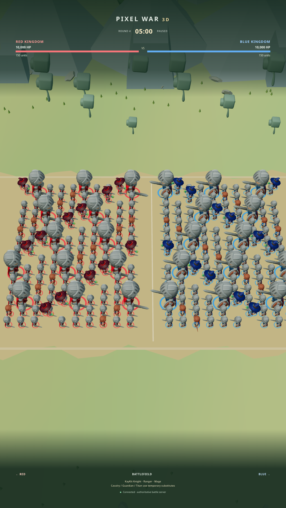
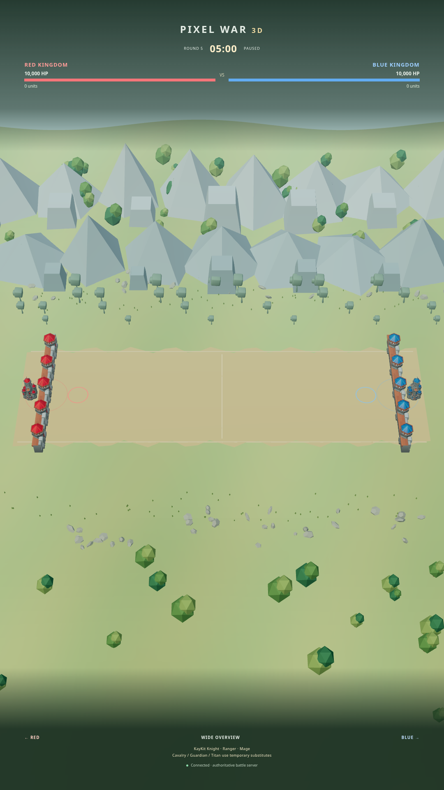

# Battlefield depth and formations

This change continues the existing KayKit/Three.js renderer. No UI kit or sound
system was added. TikTok ingestion, ownership, unit stats, combat damage,
projectiles, round handling, persistence and the 2D route remain in place.

## Formations and siege

Fifteen assigned lanes now span 1,120 simulation units (22.4 world units), with
80-unit rank spacing and 84-unit columns. Normal-unit soft separation uses a
minimum 25-unit radius; large units retain their larger collision radii. Exact
coincident positions receive deterministic separation. The spatial hash is kept.
Pursuit favors nearby lanes and steers within 0.45 lane gaps of the assigned
lane. A gentle restoring force resists frontage collapse. Casualties can still
reduce the surviving frontage; units do not teleport back into a rigid grid.

Castles accept siege targets along the whole lane interval rather than pulling
all fifteen lanes toward a narrow central point. Castle HP, damage attribution,
victory and round ending rules are unchanged. The initial 15-module fortress layout is superseded by the
[29-instance textured fortress assembly](EXTENDED-FORTRESSES.md), including gate
flanks, return walls, watchtowers and courtyard buildings along the Z edge. Modules use the supplied CC0 KayKit Medieval models at uniform
scale; no single castle is stretched. Destruction hides the corresponding
fortress when its authoritative castle HP reaches zero.

## Environment and camera

The clear dirt corridor is 30 world units deep. Rocks, grass, trees and hill
undulation sit outside it. Distant forest, CC0 KayKit rock foothills and original
MIT low-poly mountain peaks create depth layers behind combat. Far scenery uses
cooler, desaturated materials, no cast shadows, and distance fog. No screen-space
blur affects soldiers or UI. Mountains reuse licensed rock geometry plus
original polygonal peaks; they are not a new downloaded mountain pack.

The 52-degree camera defaults to automatic Battlefield mode. It follows opposing
frontline quantiles and widens before contact, then tightens as the front closes.
RED remains screen-left. Overview and castle presets remain available. Drag or
zoom switches to manual, preventing the automatic camera from undoing a user's
input. Existing HUD safe areas remain unchanged.

## Validation and reproduction

```bash
npm run setup
npm test
npm run test:battlefield --prefix live
npm run test:browser --prefix live
npm start
```

The Demo cameraScenario endpoint now accepts optional `count: 50 | 100 | 300` for
balanced-army previews. It keeps the original 300 default and Admin token guard.
`test:battlefield` uses real server units, pauses for repeatable screenshots,
checks all KayKit instances loaded and both extended fortresses, and captures
50/100/300 armies at actual 1080×1920 portrait resolution. Separate overview and
RED/BLUE fortress captures inspect the full architecture. Three new simulation
tests run eight seconds of engagement at each count and check surviving lane
spread plus outer-lane castle targeting. Existing combat/siege tests remain.

Outputs: `live/artifacts/battlefield-{50,100,300}-1080x1920.png`,
`battlefield-overview.png`, `fortress-red.png`, `fortress-blue.png`, and
`battlefield-report.json`. The report records browser, buffer resolution, FPS
samples, draw calls, triangles and formation span. FPS samples are diagnostics,
not controlled steady-state benchmarks. Tests use Chromium 155 on managed Linux
with SwiftShader software WebGL, low quality, DPR 1, no real iPad measurement.
The 300-unit fully skinned workload remains costly: thousands of draw calls and
millions of triangles can produce severe software-rendering stalls. No 60 FPS
desktop / 30 FPS iPad target is claimed; animation/geometry batching remains work.

The written visual direction was used because no accessible Douyin video was
attached. These changes are visually inspected from browser captures; similarity
to the unavailable video is not asserted. Dedicated Cavalry, Guardian and Titan
assets remain missing as documented in the KayKit repair.

## Recorded results

Production build and 53 simulation/lifecycle tests passed. The existing browser regression and new battlefield browser capture test passed with no page errors or asset 404s. Both teams spanned 1,120 simulation units in all three captures.

Software-renderer diagnostic samples (not hardware benchmarks):

| Units | Buffer    | Sample FPS | Draw calls | Triangles |
| ----- | --------- | ---------: | ---------: | --------: |
| 50    | 1080×1920 |       0.49 |        615 |    359184 |
| 100   | 1080×1920 |       0.40 |       1199 |    695392 |
| 300   | 1080×1920 |       0.22 |       3536 |   2046476 |





The screenshots above record the first battlefield redesign. See [EXTENDED-FORTRESSES.md](EXTENDED-FORTRESSES.md) for the current fortress geometry and verified framing.
