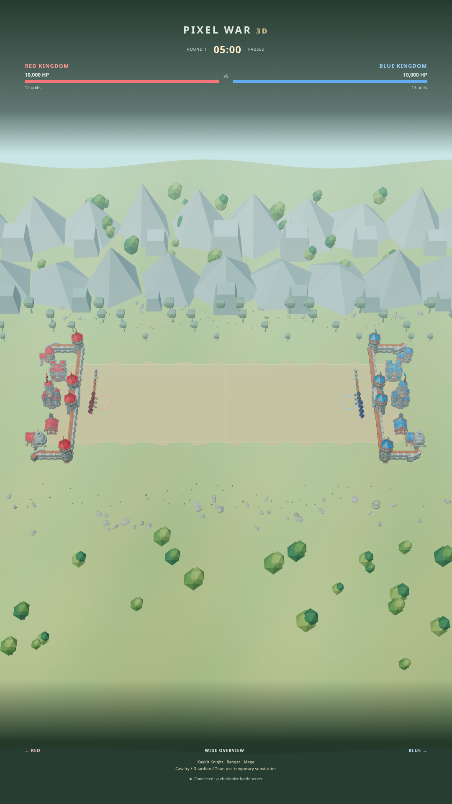
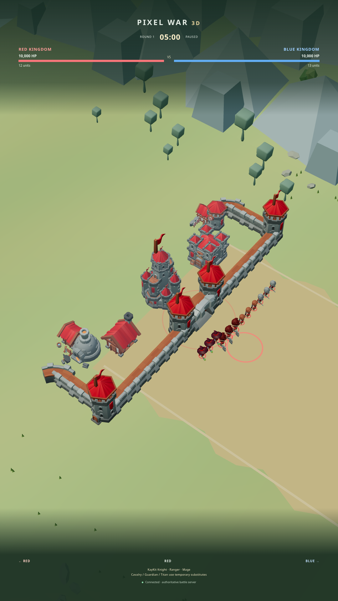
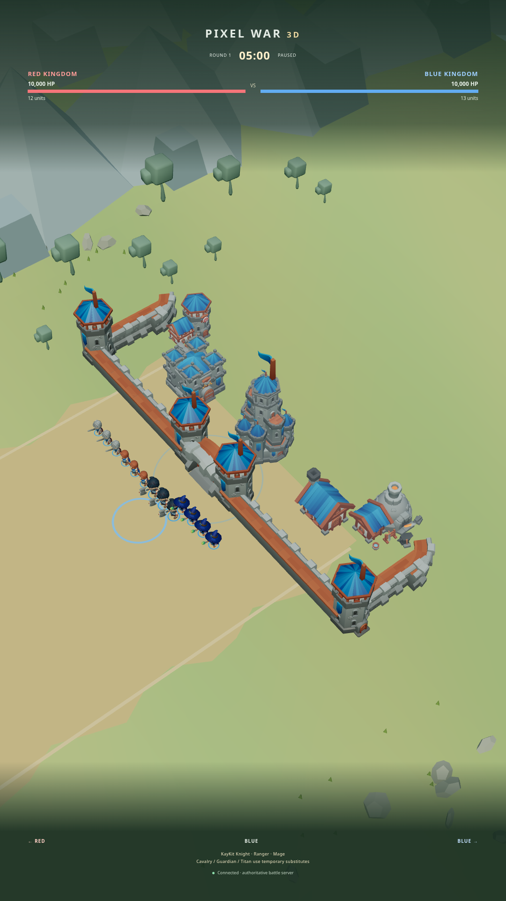

# Extended KayKit medieval fortresses

This continues the existing battlefield branch and PR #7. It reuses the
previous fortress design work and archive audit in PRs #5/#6, while retaining
the current soldiers, animations, simulation, TikTok, persistence and scenery.
The earlier PRs are not merged by this change.

## Actual archive inventory

Both existing ZIP files were opened and inspected. Part01 and Part02 together
contain 1,473 files. Part02 contains all 93 building glTF models; Part01 holds
other exports. All 93 referenced BIN files and five building PNG texture paths
are present. No building dependencies are missing. The included KayKit Medieval
license is CC0. No additional downloads, conversion, or primitive replacements
were needed.

[Complete 93-model inventory, archive paths, runtime paths and dependencies](docs/medieval-building-inventory.json).
Run `python3 live/tools/audit-medieval-castles.py` to repeat the dependency audit.
The 25 core fortress models checked by the earlier audit also pass.

Runtime model root: `/kaykit/medieval/Assets/gltf/`.

| Part                | Selected model paths relative to root                                                            |
| ------------------- | ------------------------------------------------------------------------------------------------ |
| Walls / battlements | `buildings/neutral/wall_straight.gltf`                                                           |
| Central gate        | `buildings/neutral/wall_straight_gate.gltf`                                                      |
| Return wall corners | `buildings/neutral/wall_corner_A_outside.gltf`                                                   |
| Watchtowers         | `buildings/red/building_tower_A_red.gltf`, `buildings/blue/building_tower_A_blue.gltf`           |
| Keep                | `buildings/red/building_castle_red.gltf`, `buildings/blue/building_castle_blue.gltf`             |
| Barracks            | `buildings/red/building_barracks_red.gltf`, `buildings/blue/building_barracks_blue.gltf`         |
| Home                | `buildings/red/building_home_A_red.gltf`, `buildings/blue/building_home_A_blue.gltf`             |
| Blacksmith          | `buildings/red/building_blacksmith_red.gltf`, `buildings/blue/building_blacksmith_blue.gltf`     |
| Archery range       | `buildings/red/building_archeryrange_red.gltf`, `buildings/blue/building_archeryrange_blue.gltf` |
| Flags               | `decoration/props/flag_red.gltf`, `decoration/props/flag_blue.gltf`                              |

Battlements are part of the wall/tower geometry. **Missing selected models:
none.** Load failures report their exact runtime filename; there is no silent
cube/castle fallback.

## Rendered architecture

Each team uses 29 separate textured glTF instances: eight front wall sections,
one central gate, four watchtowers, four return walls, two corner pieces, a keep,
four courtyard buildings and five flags. The gate is between two watchtowers,
with no tower placed on its center. The fortress extends approximately 44 world
units along its battlefield edge. All three scale axes stay equal on every
module; no model is stretched to form a wall. Shared geometry and textures are
reused across repeated modules.

Original RED/BLUE roofs and flag textures provide the team accents. The
courtyard materials are cloned for a subtle atmospheric emissive lift and
roughness adjustment; their original texture maps remain attached. Scene fog
adds depth without blurring troops or HUD. Gameplay remains authoritative on the
server; castle HP still controls fortress visibility/destruction through the
existing renderer state adapter.

Castle camera presets now use mirrored oblique yaw, 115-unit distance and a
slightly rearward focus so the gate faces and courtyard can be inspected.
Overview provides additional margin for the complete fortress footprints.
Battle/frontline camera behavior and character sizes are preserved.

## Actual browser verification

```bash
npm run setup
npm run test:fortresses --prefix live
npm test
npm start
```

Open forwarded port 3000, then `/3d/`. Use Overview, RED castle and BLUE castle.
The 2D fallback stays at `/legacy/` and the character inspector stays at
`/3d/gallery.html`.

The browser test checks both 29-instance fortresses, all required module kinds,
nonempty meshes, attached textures, uniform scaling and >40-unit frontage. It
also checks at least 24 existing KayKit soldier instances and rejects page/console errors
and failed asset HTTP requests. Overview and team close-ups are captured at
1080×1920, DPR 1, using Chromium 155 on Linux/SwiftShader (low quality).
These are real browser renders, not offline concept images. No physical iPad
Safari performance result is claimed.

Generated evidence: `live/artifacts/fortress-verification.json` and
`extended-fortress-{overview,red,blue}-1080x1920.png`.

## Verified results

The production build, 53 simulation/lifecycle tests and the fortress browser check passed. The final browser run loaded 29 textured modules per side and 25 existing animated-unit instances (24 founders plus a Demo reinforcement). There were zero page/console errors and zero asset HTTP failures. Projected bounds for the selected fortress in each close-up, and both fortresses in Overview, stay entirely inside the viewport. Screenshots below were opened and visually inspected. Backend, TikTok and character/animation source files were unchanged by the fortress enhancement.






