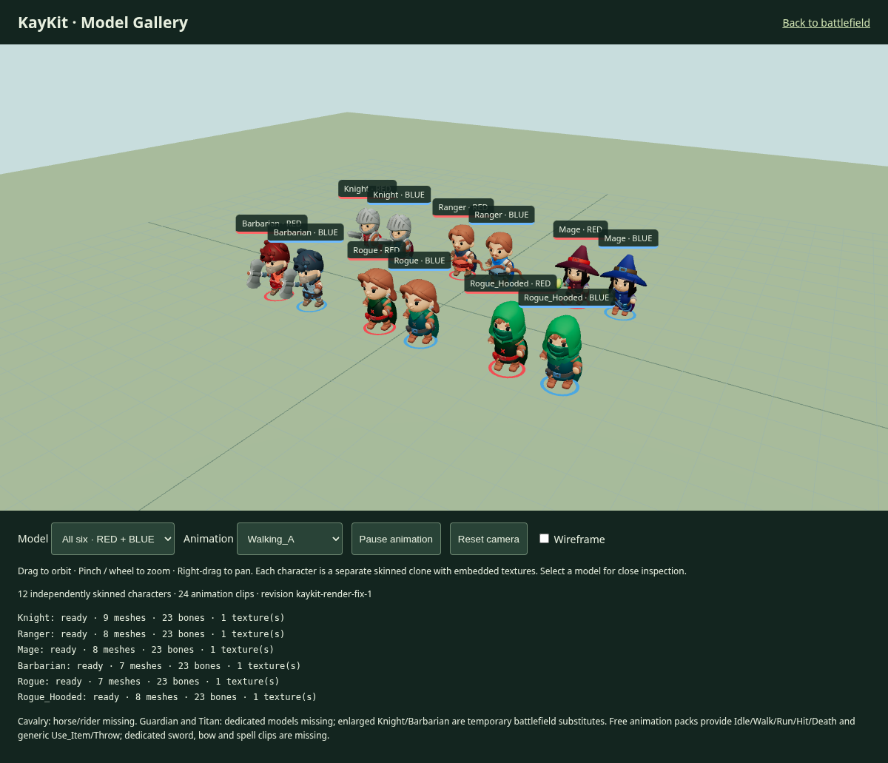
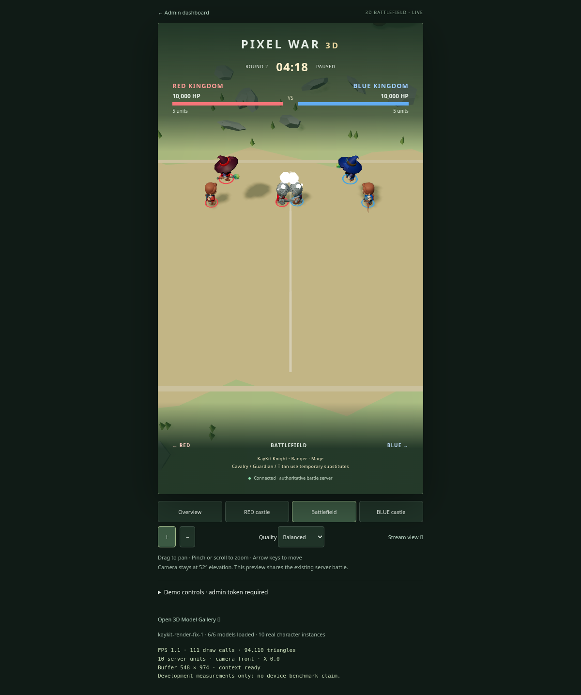
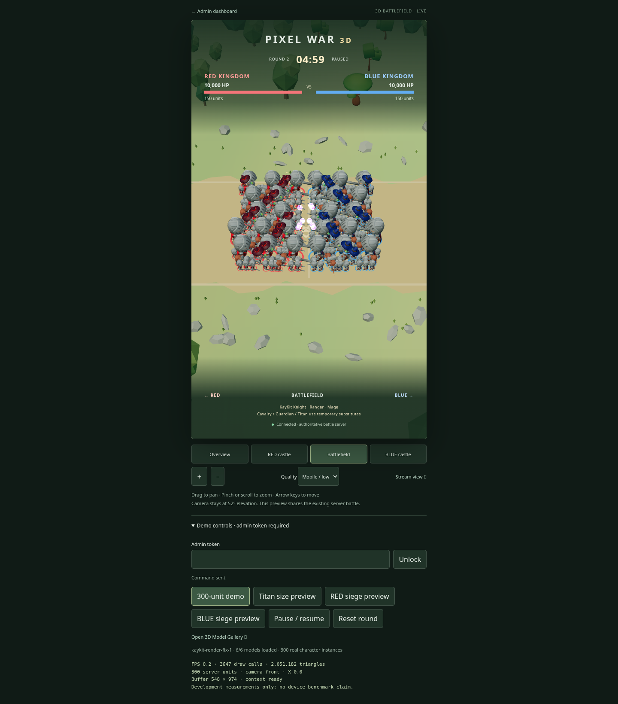

# KayKit character rendering repair

Baseline: merged PR #3, default branch commit `049fbf8`. Repair branch:
`fix/kaykit-character-rendering`. The existing 3D-primary routing is preserved:
`/` redirects to `/3d/`, and the 2D game/admin dashboard remains at `/legacy/`.

## Diagnosis

The original runtime loaded **zero character models**. A real Chromium run logged
`KayKit characters unavailable; using fallback markers: Missing KayKit character: Knight`.
The manifest matcher used `/\\.(gltf|glb)$/`, which looks for a backslash instead
of the filename's dot. Every legitimate GLB path was rejected before GLTFLoader
could request it. Capsule markers consequently remained active indefinitely.

Two further problems were found: the per-instance `scale.setScalar()` overwrote
the same wrapper used for height normalization, and the clones had no team
material variants. The single global Promise also allowed one model failure to
suppress every available character.

The archive files themselves were present, not Git LFS pointer stubs. The repair
uses the existing `KayKit_Adventurers_2.0_FREE.zip`. It contains six skinned GLBs
with embedded PNG textures, plus two separate animation GLBs. The extracted
weapon glTFs reference local BIN and PNG files. The build validator checked all
357 extracted environment/weapon glTF files and found no missing dependencies.
No asset format conversion or replacement ZIP upload was needed. The bundled
`License.txt` grants CC0 use; credit: Kay Lousberg / kaylousberg.com.

## Current model status

| Model        | Body meshes | Bones |   Textures | Runtime result                                                   |
| ------------ | ----------: | ----: | ---------: | ---------------------------------------------------------------- |
| Knight       |           9 |    23 | 1 embedded | Loaded; Swordsman; sword and shield attached                     |
| Ranger       |           8 |    23 | 1 embedded | Loaded; Archer; bow attached                                     |
| Mage         |           8 |    23 | 1 embedded | Loaded; Flying Mage; staff attached                              |
| Barbarian    |           7 |    23 | 1 embedded | Loaded; temporary dismounted Cavalry / enlarged Titan substitute |
| Rogue        |           7 |    23 | 1 embedded | Loaded; available in gallery                                     |
| Rogue_Hooded |           8 |    23 | 1 embedded | Loaded; available in gallery                                     |

No character GLB currently fails in the tested build. All have head, body, left
and right arms, left and right legs, their supplied accessories, and textures.
Cavalry's horse/rider, a dedicated Guardian and a dedicated Titan are **missing**.
Guardian uses an explicitly temporary enlarged Knight. Existing server scales
are preserved (Guardian 2.5×, Titan 3.4×); no new balance rules were introduced.

## Repair

- Exact filename matching; individual model validation and error reporting.
- GLTFLoader for models, weapon glTF/BIN/textures and separate animation packs.
- `SkeletonUtils.clone` for independent bone hierarchies and AnimationMixers.
- Nested static normalization to 1.8 world units, independent of unit scale,
  team-facing rotation (+X RED / −X BLUE), interpolation and flying height.
- Model root remains at the ground; death no longer shrinks the whole soldier.
- Embedded textures retained. Cloned clothing/armor materials tint RED/BLUE;
  faces and metal remain readable. Team ownership rings add a clear ground cue.
- Sword/shield, bow, staff and axe attach to actual hand-slot bones.
- Removed development markers from the battlefield renderer. Failed assets are
  reported in the visible status/read-only diagnostics rather than silently
  presented as complete units. Other valid characters still load independently.
- Mobile preview continues to use existing quality settings and camera bounds.
- Vite dev server now proxies `/kaykit/`, so development and production resolve
  the same models and external dependencies.

The free General + MovementBasic packs provide **24 usable clips**. Idle_A,
Walking_A, Running_A, Hit_A and Death_A are verified. Combat currently maps to
Use_Item (melee) and Throw (Archer/Mage): these are **generic temporary action
animations**, not finished sword swings, bow draw/release or spell casting.
Dedicated weapon combat, horse/rider and boss animation packs remain missing.

This repair does not claim GPU-instanced skeletal animation, a 300-unit FPS
milestone or Safari/iPad performance. Real skinned characters have a greater
rendering cost than the old capsule markers; large-army optimization remains
separate work. Backend, simulation, TikTok, persistence and 2D assets are unchanged.

## Gallery and preview

Build/run from the repository root:

```bash
npm run setup
npm run build
npm start
```

- Local battlefield: `http://localhost:3000/3d/`.
- Local gallery: `http://localhost:3000/3d/gallery.html`.
- Existing 2D game/admin: `http://localhost:3000/legacy/`.
- In Codespaces, use the forwarded port 3000 HTTPS origin with the same paths.

The gallery shows all six models in both teams (12 separately skinned clones),
labels, individual close-up selection, orbit/pan/zoom, clip selection, animation
pause, wireframe and mesh/bone/texture counts. Inspect from every side using
mouse drag or touch. It requires no Admin token and does not change the battle.

For deployment provenance, open `/kaykit/asset-version.json` on the actual preview
origin. `sourceBranch` must be `fix/kaykit-character-rendering` (or its merge),
`sourceCommit` must match the checkout used for the build, and the six character
SHA-256 values must match the repaired build. `/3d/?debug=1` displays the runtime
revision `kaykit-render-fix-1`, loaded model count and real character count.
Rebuild and restart after switching branches; merely switching Git without
rebuilding `dist/` leaves the old renderer in service. Express's existing static
file caching policy is unchanged.

The GitHub deployments API returned no deployment records during diagnosis.
No remote preview URL was provided with the issue, so the user’s already-running
Codespaces/deployed instance cannot be identified or declared updated. Local
browser verification and pushing the repair branch do not deploy that instance.

## Verification

```bash
npm test
npm run test:models --prefix live
npm run test:3d --prefix live
npm run test:browser --prefix live
```

`test:models` checks each body component, texture presence, height/ground bounds,
separate skeleton IDs, team materials and **changing skinned vertex positions**
for all twelve characters. It exercises Idle/Run/action/Death selection, then
loads a real server battle, checks normalization, verifies zero procedural
soldiers, and captures the battlefield. Page errors, failed HTTP responses and
animation-binding warnings fail the test. Separate temporary server data/token
are used; no real viewer data or TikTok session is touched.

Screenshots and machine-readable evidence are generated in ignored
`live/artifacts/`: `kaykit-gallery.png`, `kaykit-knight.png`, `kaykit-ranger.png`,
`kaykit-mage.png`, `kaykit-battlefield.png`, `kaykit-verification.json`.
The pre-fix evidence is `kaykit-before.png`. Browser: Linux headless Chromium
155 / SwiftShader, 1200×900 viewport (gallery) and 548×974 portrait drawing
buffer (battlefield). Physical iPad Safari and live TikTok were not tested.

Visual evidence from the repaired runtime:





Recorded checks: 50/50 simulation/backend tests passed; legacy browser regression passed; the model/gallery + actual-battlefield browser check passed with zero console/page errors, warnings or failed asset requests. The 300-unit capture contains real KayKit meshes (not markers). Its software renderer reported roughly 3,647 draw calls and 2.05 million triangles; this is an explicitly unoptimized workload, not a target-device FPS result.



The broad 3D browser acceptance passed, including 300 real character instances, context loss/recovery, portrait framing, responsive widths, capture mode, touch drag/pinch, mobile DPR and authorization. The 300-unit software test uses the supported low preset. After validating the army/context recovery, responsive and touch checks run on a smaller six-unit battle; the capture page is closed before starting the touch context to avoid software-GPU contention. Legacy route assertions were updated from `/` to `/legacy/` to match PR #3 routing. Camera interpolation now uses elapsed wall time, preserving transition timing when heavy rendering slows the frame loop.
